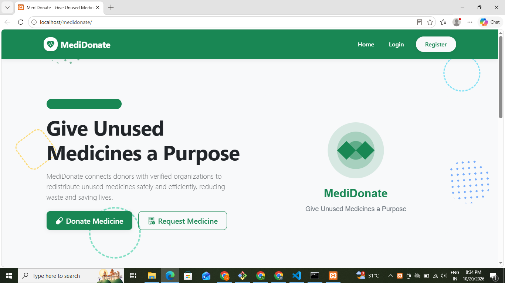
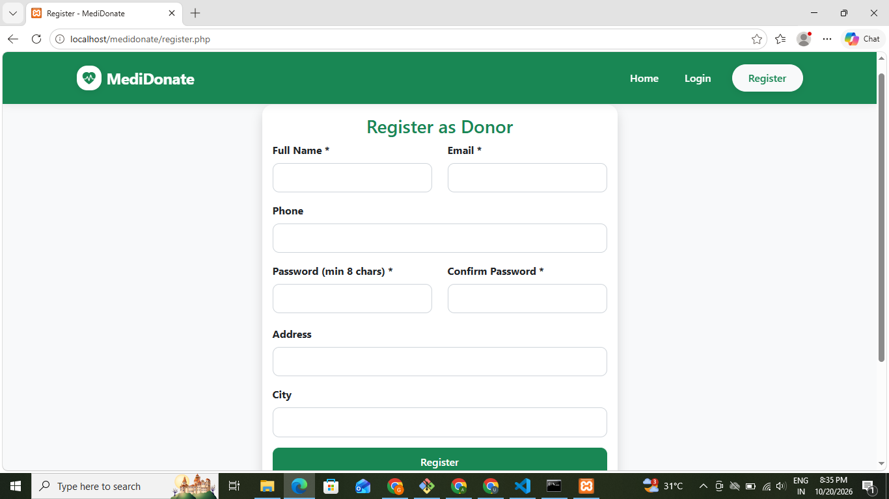
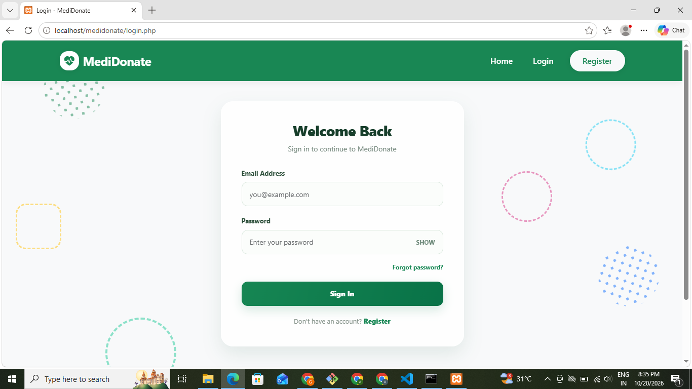
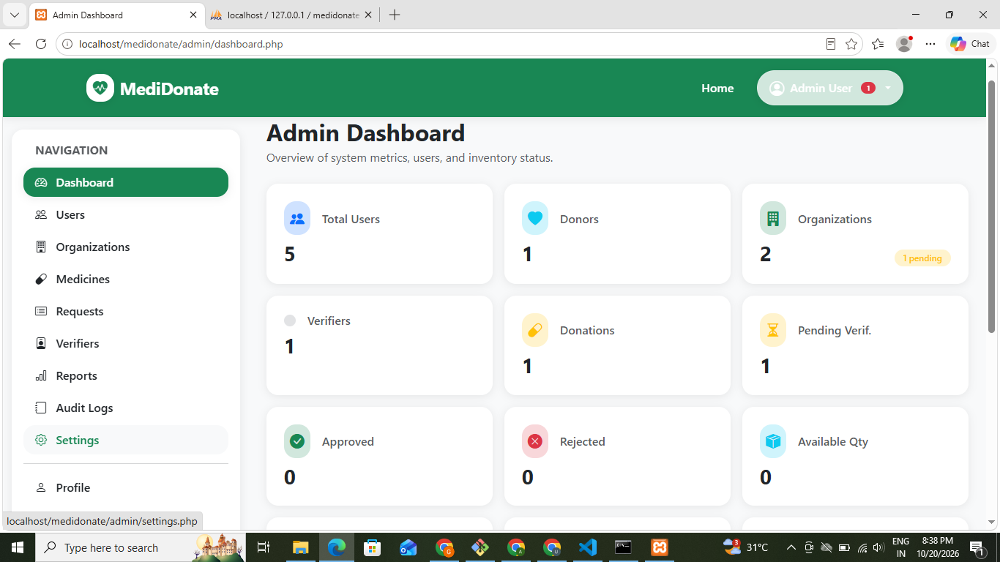
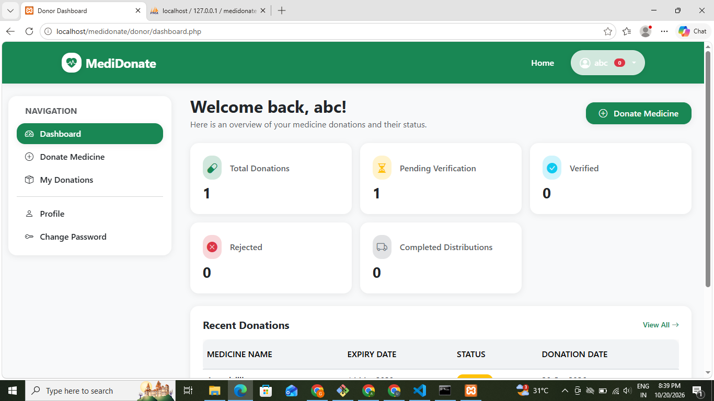
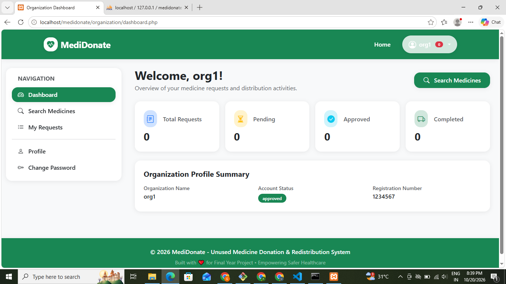

# MediDonate – Unused Medicine Donation & Redistribution System

## 1. Project Overview

MediDonate is a web-based application developed using PHP and MySQL to facilitate the safe donation and redistribution of unused medicines. It connects medicine donors with verified organizations that need medicines, helping reduce medicine wastage and improve access to essential healthcare resources.

The system provides separate interfaces for administrators, donors, organizations, and verifiers to manage medicine donations, verification, requests, and distribution.

## 2. Objectives

- Reduce wastage of unused medicines.
- Connect donors with approved organizations.
- Provide a platform for medicine donation and requests.
- Verify donated medicines before redistribution.
- Track medicine donations and distribution status.
- Improve transparency and accountability.
- Support safe and responsible medicine redistribution.

## 3. Technology Stack

- **Frontend:** HTML, CSS, JavaScript, Bootstrap
- **Backend:** PHP
- **Database:** MySQL
- **Database connectivity:** PDO
- **Local development server:** XAMPP (Apache)
- **Email integration:** PHPMailer and SMTP
- **Dependency management:** Composer

## 4. Main Features

### Admin Module
- Admin dashboard
- Manage users and verifiers
- Manage organizations and approval status
- Manage medicines and requests
- View reports and audit logs
- Configure system settings
- Manage profile and notifications

### Donor Module
- Donor registration and login
- Donor dashboard
- Donate unused medicines
- Submit medicine details and images
- View donation history and donation status
- Manage profile and password
- Receive notifications

### Organization Module
- Organization registration and profile
- Organization dashboard
- Browse available medicines
- Request medicines
- Track medicine requests
- View request details and history
- Cancel eligible requests
- Confirm receipt of distributed medicines
- Receive notifications

### Verifier Module
- Verifier dashboard
- Review pending medicine donations
- Verify medicine details
- Review medicine requests
- View verification history
- Monitor medicines approaching expiry
- Manage profile and notifications

### Authentication Module
- User registration
- Login and logout
- Forgot-password functionality
- Password reset
- Session and authentication management

## 5. Project Folder Structure

```text
medidonate/
│
├── admin/
│   ├── audit-logs.php
│   ├── change-password.php
│   ├── dashboard.php
│   ├── medicines.php
│   ├── notifications.php
│   ├── organizations.php
│   ├── profile.php
│   ├── reports.php
│   ├── requests.php
│   ├── settings.php
│   ├── users.php
│   └── verifiers.php
│
├── assets/
│   ├── css/
│   │   └── style.css
│   ├── images/
│   │   └── hero.svg
│   └── js/
│       ├── script.js
│       └── validation.js
│
├── config/
│   ├── auth.php
│   ├── database.php
│   ├── functions.php
│   ├── mail.php
│   └── validation.php
│
├── database/
│   └── medidonate.sql
│
├── donor/
│   ├── change-password.php
│   ├── dashboard.php
│   ├── donate-medicine.php
│   ├── donation-details.php
│   ├── my-donations.php
│   ├── notifications.php
│   └── profile.php
│
├── includes/
│   ├── alerts.php
│   ├── footer.php
│   ├── header.php
│   ├── navbar.php
│   └── sidebar.php
│
├── organization/
│   ├── cancel-request.php
│   ├── change-password.php
│   ├── confirm-receipt.php
│   ├── dashboard.php
│   ├── medicine-details.php
│   ├── medicines.php
│   ├── my-requests.php
│   ├── notifications.php
│   ├── profile.php
│   ├── request-details.php
│   └── request-medicine.php
│
├── uploads/
│   ├── medicines/
│   └── organizations/
│
├── vendor/
│   └── Composer dependencies
│
├── verifier/
│   ├── change-password.php
│   ├── dashboard.php
│   ├── expiring-medicines.php
│   ├── medicine-details.php
│   ├── notifications.php
│   ├── pending-medicines.php
│   ├── profile.php
│   ├── request-details.php
│   ├── requests.php
│   └── verification-history.php
│
├── composer.json
├── composer.lock
├── forgot-password.php
├── index.php
├── login.php
├── logout.php
├── register.php
├── reset-admin.php
└── reset-password.php
```

## 6. System Requirements

- Windows, Linux, or macOS
- XAMPP or another compatible PHP development environment
- Apache web server
- MySQL or MariaDB
- A PHP version compatible with the project
- Composer for installing PHP dependencies

## 7. Installation and Setup

### Step 1: Install XAMPP

Install XAMPP and start Apache and MySQL from the XAMPP Control Panel.

### Step 2: Place the Project

Copy or extract the project folder into:

```text
C:\xampp\htdocs\medidonate
```

### Step 3: Create the Database

1. Open your browser.
2. Visit `http://localhost/phpmyadmin/`.
3. Select the Import option.
4. Choose the SQL file:

```text
database/medidonate.sql
```

5. Import the file and verify that the database and tables have been created successfully.

Follow the database name specified in the SQL file and the application's configuration.

### Step 4: Configure Database Connectivity

Open:

```text
config/database.php
```

Check the following settings:

- Database host
- Database name
- MySQL username
- MySQL password

For a default local XAMPP installation, the host is commonly `localhost` and the username is `root`. Use the credentials configured on your computer.

### Step 5: Install Dependencies

Open a terminal in the project directory and run:

```bash
cd C:\xampp\htdocs\medidonate
composer install
```

Run this command if the required Composer dependencies are missing or need to be restored.

### Step 6: Configure Email

Open:

```text
config/mail.php
```

Configure the SMTP server and email credentials if the application uses email for password recovery or notifications. Keep credentials private.

### Step 7: Run the Application

Open the following URL in your browser:

```text
http://localhost/medidonate/
```

Register an account or log in to access the available features.

## 8. UI Screenshots







## 9. Database Management

The database stores information required to manage the application's workflows.

Depending on the supplied SQL schema, the database may include information related to:

- User accounts and roles
- Organization profiles and approval status
- Medicine donations and verification
- Medicine requests
- Inventory and redistribution
- Distribution records
- Notifications
- Audit logs
- Password reset information
- System settings

Refer to `database/medidonate.sql` for the exact table names, columns, relationships, and constraints.

## 10. Application Workflow

1. **Registration:** Donors and organizations register through the application.
2. **Donation:** Donors submit information about unused medicines.
3. **Verification:** Authorized verifiers review the submitted medicine information.
4. **Availability:** Medicines approved for redistribution become available according to the application's status rules.
5. **Request:** Organizations browse available medicines and submit requests.
6. **Distribution:** Approved requests proceed through the distribution workflow.
7. **Confirmation:** The receiving organization confirms receipt when required.
8. **Monitoring:** Administrators and verifiers monitor records, statuses, and relevant notifications.

Actual workflow steps depend on the implemented permissions and status transitions.

## 11. Benefits

- Helps reduce medicine wastage.
- Connects donors with organizations in need.
- Supports organized medicine donation management.
- Provides a verification workflow.
- Improves tracking and transparency.
- Helps organizations discover available medicines.
- Maintains records of requests and distributions.

## 12. Troubleshooting

### Database Connection Error
- Ensure MySQL is running.
- Verify credentials in `config/database.php`.
- Confirm that the database was imported successfully.

### Homepage Image Not Displaying
- Check that `assets/images/hero.svg` exists.
- Confirm that the image path in `index.php` matches the filename.

### Email Functionality Not Working
- Verify SMTP settings in `config/mail.php`.
- Ensure required Composer dependencies are installed.
- Check the PHP and Apache error logs.

### Blank Page or PHP Error
- Check the Apache/PHP error logs in XAMPP.
- Verify the PHP version and required extensions.
- Confirm that the database tables exist.
- Ensure required files in the `vendor/` directory are available.

### Upload Errors
- Check that the appropriate upload directories exist.
- Verify file permissions and PHP upload-size limits.
- Validate uploaded files on the server.

## 13. Security Considerations

- Keep database and SMTP credentials private.
- Restrict access to administrative functions.
- Protect or remove `reset-admin.php` before public deployment.
- Validate uploaded files and limit permitted file types and sizes.
- Use secure sessions and HTTPS in production.
- Enforce role-based access control.
- Protect sensitive user information.
- Ensure medicine acceptance and redistribution follow applicable laws and are reviewed by authorized personnel.

MediDonate helps manage the donation process; it does not independently certify that a medicine is medically safe.

## 14. Future Enhancements

Potential future improvements include:

- Email and in-app notification improvements.
- Advanced reporting and analytics.
- Improved medicine expiry alerts.
- Better mobile responsiveness.
- Enhanced audit and traceability features.
- Additional security testing.
- Integration with authorized healthcare organizations.

## 15. Conclusion

MediDonate provides a centralized platform for coordinating unused medicine donations and redistribution. By connecting donors, verifiers, administrators, and organizations, the project aims to reduce wastage, improve coordination, and support responsible access to unused medicines.

This README describes the visible project structure and general setup process. Verify the database configuration, email settings, dependencies, and security controls in the local environment before deploying the application.
